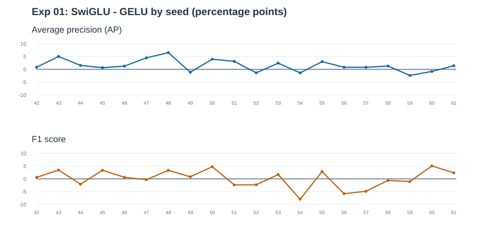

# Exp 01 — Gated vs ungated FFNs

**Question:** Does SwiGLU improve tabular classification under an approximately equal parameter budget?

## Controlled setup

| Setting | Value |
|---|---|
| Dataset | [ULB credit-card fraud](https://www.kaggle.com/datasets/mlg-ulb/creditcardfraud) |
| Rows | 283,726 after deduplication; 30 numerical input features |
| Split | Stratified 70/15/15, resampled per seed |
| Architecture | Pre-LN, four encoder blocks, four attention heads, width 96, CLS, no dropout |
| Trainable params | Ungated MLP 453,602; SwiGLU 454,114 |
| Selection | Best validation AP; validation-selected F1 threshold |

## Original comparison — GELU vs SwiGLU, 20 seeds (42–61)

| Metric | GELU | SwiGLU | SwiGLU − GELU |
|---|---:|---:|---:|
| Precision | 0.8479 | 0.8711 | 2.32 pp |
| Recall | 0.7760 | 0.7613 | -1.48 pp |
| F1 | 0.8089 | 0.8095 | 0.06 pp |
| Average precision | 0.7930 | 0.8081 | 1.51 pp |

SwiGLU wins 15/20 paired AP comparisons and 11/20 F1 comparisons.

**Finding:** AP favors SwiGLU modestly; F1 is approximately tied. Test sets across random splits overlap, so runs are not independent datasets.

## SiLU / Swish ungated MLP ablation — three seeds (42–44)

| Metric | SiLU MLP | SwiGLU |
|---|---:|---:|
| Precision | 0.8644 | 0.8789 |
| Recall | 0.8075 | 0.7934 |
| F1 | 0.8340 | 0.8328 |
| AP | 0.8180 | 0.8382 |

**Preliminary only:** Three paired seeds; the original SiLU ablation log has not been committed.

## Generalization observation

Training CE continues falling as validation CE rises. Validation AP may still improve: calibration deterioration and ranking deterioration are not equivalent. The capacity hypothesis motivates [Exp 02](02_capacity_scaling.md).

20-seed source: [experiment_20seeds.log](../experiment_20seeds.log). No causal or universal architectural claim.
