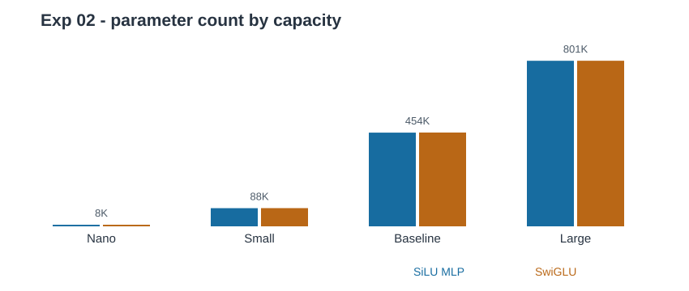

# Exp 02 — Model capacity and generalization

**Question:** Does model scale affect validation-loss deterioration and the SwiGLU-vs-SiLU comparison?

## Run

From repository root, inside the activated uv environment; run in tmux:

~~~bash
python -m experiments.exp02.exp02 --csv data/creditcard.csv 2>&1 | tee exp2_run.log
~~~

Preflight (does not train):

~~~bash
python -m experiments.exp02.exp02 --dry-run
~~~

Output is in **exp2/** and never overwrites historical **results/**.

## Design — 4 scales × 2 FFNs × 3 seeds = 24 fits

| Scale | d_model | Layers | Heads | SiLU MLP params | SwiGLU params |
|---|---:|---:|---:|---:|---:|
| Nano | 16 | 2 | 2 | 7,602 | 7,678 |
| Small | 48 | 3 | 4 | 87,938 | 88,130 |
| Baseline | 96 | 4 | 4 | 453,602 | 454,114 |
| Large | 128 | 4 | 4 | 801,410 | 801,578 |

| Control | Value |
|---|---|
| Seeds | 42, 43, 44 (paired splits within each seed) |
| MLP | SiLU, expansion 4d |
| SwiGLU | SiLU-gated, expansion approximately 8d/3 |
| Duration | 16 fixed epochs; early stopping off |
| Regularization | No dropout; AdamW weight decay 0.01 |
| Other | Same data splits, optimizer, LR policy, clipping, accumulation per pair |
| Model selection | Highest validation AP (not lowest validation CE) |

The 16-epoch LR schedule differs from Exp 01 (20 epochs). Do not treat raw score differences across these runs as an isolated scale effect.

## Outputs

| File | Content |
|---|---|
| exp2/{nano,small,baseline,large}/ | Per-seed checkpoints, metrics, predictions and loss curves |
| exp2/seed_metrics.csv | Per-seed model performance |
| exp2/epoch_history.csv | Complete 16-epoch train/validation curves |
| exp2/capacity_summary.csv | Mean and SD by capacity/model |
| exp2/overfitting_summary.csv | CE minimum epoch, AP maximum epoch, final CE rise and gap |

Complete, configuration-matched capacities are skipped on rerun. Incomplete/mismatched capacities halt rather than silently overwrite. Use --force only if you intend to replace one.

## Results (fill after the run)

| Scale | SiLU test AP | SwiGLU test AP | ΔAP | Min val CE (SiLU / SwiGLU) |
|---|---:|---:|---:|---:|
| Nano | TBD | TBD | TBD | TBD |
| Small | TBD | TBD | TBD | TBD |
| Baseline | TBD | TBD | TBD | TBD |
| Large | TBD | TBD | TBD | TBD |

**Limitation:** Both model width and depth change across scale points. This tests scale-associated generalization, not whether parameter count alone causes overfitting. Weighted CE also measures probability confidence, not only discrimination.
